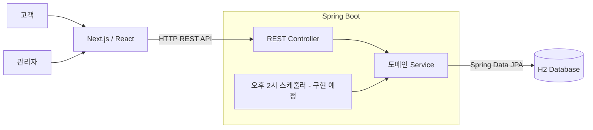
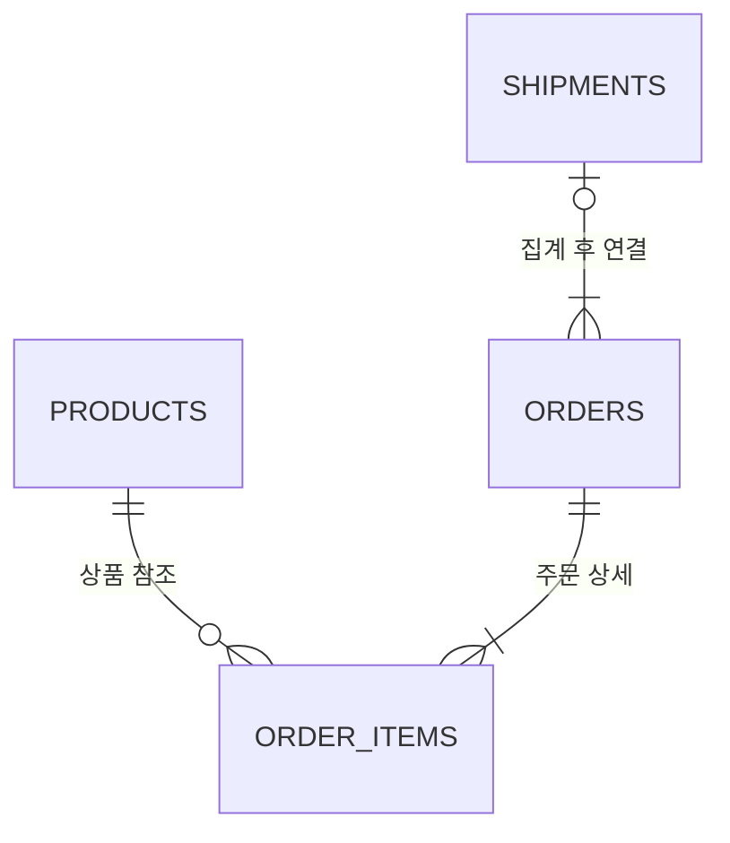

# ☕ Grids & Circles

**로컬 카페의 커피 원두 주문 및 관리 서비스**

Grids & Circles는 고객이 회원가입 없이 커피 원두를 주문하고, 관리자가 상품과 주문 및 배송 그룹을 관리할 수 있도록 설계한 웹 서비스입니다.

매일 오후 2시를 기준으로 주문을 집계하고, 동일 고객의 동일 집계 기간·동일 배송지 주문을 하나의 배송 단위로 묶는 것이 핵심입니다. 개별 주문 이력과 주문 당시 상품 가격은 그대로 보존합니다.

> 프로그래머스 백엔드 데브코스 1차 팀 프로젝트
> 
> 
> 팀: 삼겹살 | 개발 기간: 2026.11.26 ~ 2026.12.03
> 

## 1. 프로젝트 목표

- Java와 Spring Boot 기반 REST API 설계 및 CRUD 구현
- Spring Data JPA 기반 관계형 데이터베이스 설계 및 연동
- React 기반의 고객·관리자 화면 구현 및 API 연동
- 오후 2시 주문 집계 및 배송 그룹 병합 비즈니스 로직 구현
- GitHub Flow, 코드 리뷰, 공통 컨벤션을 통한 협업 경험

## 2. 주요 기능 및 개발 범위

아래는 프로젝트의 목표 기능이며, 초기 세팅 완료 상태를 실제 기능 구현 완료로 의미하지 않습니다.

| 영역 | 기능 |
| --- | --- |
| 고객 | 상품 목록·상세 조회, 원두 선택 및 주문 접수 |
| 주문 | 이메일 기반 고객 식별, 주문 상세 조회, 마감 전 수정·취소 |
| 상품 관리 | 상품 등록·조회·수정·삭제(논리적 삭제) |
| 배송 관리 | 오후 2시 주문 자동 집계, 동일 고객·배송지별 병합, 배송 목록·상세 조회 |
| 운영 관리 | 관리자 주문 목록 및 상세 조회 |

기본 기능을 완료한 이후 재고 관리, 주문 검색·페이지네이션, 매출·인기 상품 통계, 실시간 알림(SSE), 클라우드 배포 등의 선택 과제를 검토합니다. 별도의 회원가입과 실제 택배 배송 추적은 이번 기본 범위에 포함하지 않습니다.

## 3. 핵심 비즈니스 규칙

### 주문 집계

모든 시각은 한국 표준시(KST, Asia/Seoul)를 기준으로 합니다.

- 전날 14:00 이상부터 당일 14:00 미만까지의 주문은 당일 집계 대상입니다.
- 정확히 14:00:00에 접수된 주문부터 다음 집계일에 포함합니다.
- 같은 이메일, 집계 마감일, 배송 주소 및 우편번호를 가진 유효 주문을 한 배송 그룹으로 묶습니다.
- 동일 이메일이더라도 배송지가 다르면 별도로 처리합니다.
- 취소된 주문과 이미 배송에 연결된 주문은 신규 집계 대상에서 제외합니다.

| 주문 접수 시각 예시 | 집계 마감일 |
| --- | --- |
| 2026.11.27 13:59:59 | 2026.11.27 |
| 2026.11.27 14:00:00 | 2026.11.28 |

### 주문 이력 및 가격 보존

- 주문 당시 단가는 주문 상세에 별도로 저장합니다.
- 이후 상품 가격이 변경되어도 기존 주문 단가는 유지됩니다.
- 상품 삭제는 논리적 삭제 방식으로 처리하며 기존 주문 기록은 유지합니다.
- 개별 주문은 집계 후에도 삭제하거나 하나의 주문 행으로 합치지 않습니다.
- 주문의 수정 및 취소는 해당 마감 시각 이전까지만 허용하는 것을 목표로 합니다.

## 4. 팀원 및 역할

| 팀원 | 담당 영역 | 주요 책임 |
| --- | --- | --- |
| 예원 | 상품·재고 | 상품 CRUD 및 주문 가능 상품 정보 제공, 재고 확장 검토 |
| 민석 | 주문·고객 | 주문 생성·조회·수정·취소, 가격 및 주문 상세 관리 |
| 원석 | 배송 | 오후 2시 집계, 주문 병합, 배송 그룹 생성·조회 |
| 세찬 | 운영·조회 | 관리자 주문 조회, 통계 및 알림 확장 검토 |

## 5. 기술 스택

버전 기준: 2026.11.27 main 브랜치 초기 세팅의 설정 파일.

| 분류 | 기술 |
| --- | --- |
| Backend | Java 21, Spring Boot 4.2.0, Spring MVC, Spring Data JPA, Validation, Lombok |
| Database | H2 (로컬 파일 DB, 테스트 인메모리 DB 설정) |
| Build & Test | Gradle Wrapper 9.9.2, JUnit Platform |
| API Documentation | springdoc-openapi 3.2.1, Swagger UI |
| Frontend | Next.js 16.4.6 (App Router), React 19.3.0, TypeScript 5.x |
| UI & Styling | Tailwind CSS 4.3.3, shadcn/ui, Radix UI, Figma 디자인 토큰 |
| Runtime & Package | Node.js 24, pnpm 12.21.0 |
| Code Quality | Checkstyle 10.26.1, ESLint, Prettier, EditorConfig |
| Collaboration & CI | Git, GitHub, GitHub Flow, Husky, lint-staged, commitlint, GitHub Actions |

정확한 의존성 버전은 [backend/build.gradle](backend/build.gradle), [frontend/package.json](frontend/package.json) 및 lockfile을 기준으로 합니다.

## 6. 시스템 구성



고객과 관리자는 하나의 프론트엔드 애플리케이션에서 서로 다른 라우트를 사용합니다. 백엔드는 공통 REST API 서버에서 요청을 처리하며, 배송 집계 로직은 스케줄러를 통해 실행하는 구조를 목표로 합니다.

### ERD 요약



| 테이블 | 역할 |
| --- | --- |
| products | 상품 정보 및 현재 판매 가격 |
| orders | 고객 정보, 개별 주문 및 집계 마감일 |
| order_items | 주문 상품, 수량, 주문 당시 단가 |
| shipments | 동일 배송 조건을 충족하는 주문 그룹 |

주문은 집계 전 배송 ID가 NULL일 수 있습니다. 집계 이후 여러 개별 주문이 동일한 배송 ID를 참조합니다. 실제 배송 추적 상태는 현재 설계 범위에서 제외합니다.

세부 컬럼과 제약조건은 팀 노션의 ERD 상세 명세서를 기준으로 합니다.

## 7. 프로젝트 구조

```
NBE14-16-1-pork/
├── backend/                     # Spring Boot API 서버
│   ├── src/main/java/com/gridsandcircles/
│   │   └── global/              # 공통 설정, Entity 기반 클래스, 예외, 응답
│   ├── src/main/resources/
│   ├── src/test/
│   ├── build.gradle
│   ├── rule-config/
│   └── README.md
├── frontend/                    # Next.js 고객 및 관리자 웹
│   ├── src/app/
│   │   ├── (customer)/          # 고객 라우트
│   │   └── admin/               # 관리자 라우트
│   ├── src/components/ui/       # 공통 UI 컴포넌트
│   ├── src/lib/                 # 환경변수 및 유틸리티
│   ├── src/styles/              # 디자인 토큰
│   └── README.md
├── .github/
│   ├── CONTRIBUTING.md
│   ├── PULL_REQUEST_TEMPLATE.md
│   └── workflows/
├── .husky/                      # Git 훅
├── package.json                # 공통 협업 도구
└── README.md
```

백엔드는 도메인 중심 패키지(product, order, shipment 및 관리자 통합 조회 영역)를 구성하고, 각 영역 내부에 Controller, Service, Repository, Entity, DTO를 필요한 만큼 분리합니다. 기능 개발에 따라 구조가 확장됩니다.

## 8. 로컬 실행 방법

### 8-1. 사전 준비

- JDK 21
- Node.js 24
- pnpm 12.21.0
- Git

Gradle은 저장소에 포함된 Wrapper를 사용하므로 별도 설치가 필요하지 않습니다.

### 8-2. 저장소 복제 및 공통 도구 설치

```bash
git clone https://github.com/prgrms-be-devcourse/NBE14-16-1-pork.git
cd NBE14-16-1-pork
pnpm install
```

루트의 pnpm install은 Husky, lint-staged, commitlint 등 공통 협업 도구를 설정합니다. 백엔드 작업자도 최초 한 번 실행합니다. 저장소 접근 권한이 필요할 수 있습니다.

### 8-3. 백엔드 실행

저장소 루트에서:

```bash
cd backend
./gradlew bootRun
```

Windows PowerShell:

```powershell
cd backend
.\gradlew.bat bootRun
```

| 서비스 | 주소 |
| --- | --- |
| API 서버 | [http://localhost:8080](http://localhost:8080/) |
| Swagger UI | [http://localhost:8080/swagger-ui.html](http://localhost:8080/swagger-ui.html) |
| H2 콘솔 | [http://localhost:8080/h2-console](http://localhost:8080/h2-console) |

H2 콘솔 접속 설정:

| 항목 | 값 |
| --- | --- |
| JDBC URL | jdbc:h2:[file:./data/gridsandcircles;MODE=MySQL](file:///data/gridsandcircles;MODE=MySQL) |
| User Name | sa |
| Password | 비워둠 |

백엔드 실행 위치를 backend 폴더로 유지합니다. 위 H2 설정은 로컬 개발용입니다. 운영 환경에 H2 콘솔, 기본 계정 및 상세 파라미터 로깅을 그대로 노출하지 않습니다.

### 8-4. 프론트엔드 실행

새 터미널을 열고 저장소 루트에서 다음 명령을 실행합니다.

```bash
cd frontend
pnpm install
cp .env.example .env.local
pnpm dev
```

Windows PowerShell:

```powershell
cd frontend
pnpm install
Copy-Item .env.example .env.local
pnpm dev
```

환경변수 복사는 최초 1회만 수행하며, 이미 설정한 .env.local이 있으면 덮어쓰지 않습니다.

```
NEXT_PUBLIC_API_BASE_URL=http://localhost:8080
```

| 화면 | 주소 |
| --- | --- |
| 고객 | [http://localhost:3000](http://localhost:3000/) |
| 관리자 | [http://localhost:3000/admin](http://localhost:3000/admin) |

API 서버 주소는 frontend의 src/lib/env.ts에서 공통 관리합니다. .env.local은 커밋하지 않습니다. NEXT_PUBLIC_ 환경변수에는 브라우저에 노출되면 안 되는 비밀값을 넣지 않습니다.

프론트엔드와 백엔드는 각각 별도 터미널에서 실행합니다.

## 9. API 공통 응답

일반 JSON API는 ApiResponse의 공통 형식을 사용합니다.

성공 예시:

```json
{
  "code": 200,
  "message": null,
  "content": {
    "productId": 1
  }
}
```

오류 예시:

```json
{
  "code": 40401,
  "message": "상품을 찾을 수 없습니다.",
  "content": null
}
```

위 응답 데이터는 공통 응답 형식을 설명하기 위한 예시입니다.

- 정상 응답의 code는 200이며, HTTP 상태는 요청 종류에 따라 200 또는 201 등으로 구분합니다.
- 비즈니스 오류는 공통 ErrorCode를 사용합니다.
- source of truth: 백엔드 ApiResponse/ErrorCode 및 팀 API 명세서의 최종 계약.
- OpenAPI 문서는 Swagger UI에서 확인할 수 있으며 개별 엔드포인트는 구현 후 표시됩니다.
- SSE를 구현할 경우 스트리밍 응답 형식은 일반 JSON 응답과 별도로 정의합니다.

## 10. 테스트 및 코드 품질 검사

### Backend

backend 디렉터리에서 실행합니다.

```bash
./gradlew test
./gradlew build
```

Windows에서는 `./gradlew` 대신 `.\gradlew.bat`를 사용합니다.

Checkstyle은 빌드 과정에서 Java 소스의 컨벤션을 검사합니다. DB 테스트는 test 프로파일의 인메모리 H2 설정을 활용합니다.

### Frontend

frontend 디렉터리에서 실행합니다.

```bash
pnpm format:check
pnpm lint
pnpm typecheck
pnpm build
```

frontend 변경 PR에 대해 GitHub Actions의 Frontend CI가 포맷, 린트, 타입 및 빌드를 검사합니다.

## 11. 협업 방식

- GitHub Flow 기반으로 main에서 작업 브랜치를 생성합니다.
- 직접 main에 push하지 않고 Pull Request를 생성하여 리뷰합니다.
- 합의된 팀 커밋 메시지·PR 규칙을 지키고 Squash and merge로 병합합니다.
- 브랜치·커밋·PR 상세 규칙은 [CONTRIBUTING.md](.github/CONTRIBUTING.md)를 기준으로 합니다.
- Java 코딩 컨벤션과 IntelliJ 설정은 [Backend README](backend/README.md)를 참고합니다.
- 프론트엔드 환경변수, 디자인 토큰 및 코드 품질 도구는 [Frontend README](frontend/README.md)를 참고합니다.

## 12. 프로젝트 문서

| 문서 | 위치 |
| --- | --- |
| 백엔드 개발 가이드 | [backend/README.md](backend/README.md) |
| 프론트엔드 개발 가이드 | [frontend/README.md](frontend/README.md) |
| 협업 규칙 | [.github/CONTRIBUTING.md](.github/CONTRIBUTING.md) |
| PR 템플릿 | [.github/PULL_REQUEST_TEMPLATE.md](.github/PULL_REQUEST_TEMPLATE.md) |
| 요구사항, 비즈니스 규칙, ERD, API 명세, WBS, 패키지 구조 | 팀 노션 |

## 13. 향후 업데이트

- 각 도메인 구현이 완료되면 실제 구현 기능과 API를 기준으로 프로젝트 상태를 업데이트합니다.
- 최종 ERD 이미지, 고객·관리자 화면 스크린샷과 시연 자료를 추가합니다.
- 선택 기능과 클라우드 배포 주소는 실제 구현 또는 배포가 검증된 경우에만 추가합니다.